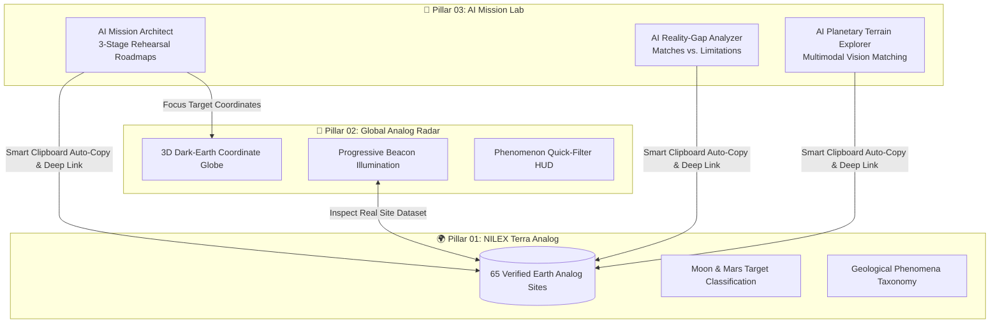

<div align="center">

<!-- ANIMATED MISSION-CONTROL HEADER -->
<a href="https://nilex.onhercules.app/explore">
  
</a>

### **See What Matches. Understand What Differs. Prepare Before Launch.**

*Before crewed landers descend to the lunar South Pole or autonomous rovers drill into Martian permafrost, every instrument, spacesuit, and survival protocol is rehearsed in extreme terrestrial environments right here on Earth.*

<br>

<!-- PRIMARY LAUNCH ACTION BUTTONS -->
<p>
  <a href="https://nilex.onhercules.app/explore">
    
  </a>
  <a href="https://gamenelix.lovable.app/">
    
  </a>
  <a href="#-pillar-iii-ai-mission-lab">
    
  </a>
</p>

<br>

<!-- MISSION TELEMETRY KPI STRIP -->
<table>
  <tr>
    <td align="center" width="240">
      <h2>🌍 65</h2>
      <b>Verified Analog Sites</b><br />
      <sub>Mapped across all 7 continents</sub>
    </td>
    <td align="center" width="240">
      <h2>🌑 🔴</h2>
      <b>Moon & Mars Targets</b><br />
      <sub>8 key geological phenomena</sub>
    </td>
    <td align="center" width="240">
      <h2>🛰️ 3 Pillars</h2>
      <b>Unified Command Hub</b><br />
      <sub>Catalog • Radar • Multimodal AI</sub>
    </td>
  </tr>
</table>

<br>

<!-- 🖼️ IMAGE PLACEHOLDER 1: MAIN HERO BANNER -->

<p><sub><i>[ Replace <code>assets/images/00-hero-banner.png</code> with your main ecosystem showcase screenshot ]</i></sub></p>

<br>

<!-- QUICK NAVIGATION BAR -->
<p>
  <a href="#-live-ecosystem-launchpad"><b>🌐 Launchpad</b></a> &nbsp;•&nbsp;
  <a href="#-visual-showcase--screenshot-gallery"><b>📸 Visual Gallery</b></a> &nbsp;•&nbsp;
  <a href="#-the-operational-challenge--our-solution"><b>🔭 Why NILEX</b></a> &nbsp;•&nbsp;
  <a href="#-system-architecture"><b>🏗️ Architecture</b></a> &nbsp;•&nbsp;
  <a href="#-interactive-pillar-explorer"><b>✨ Core Modules</b></a> &nbsp;•&nbsp;
  <a href="#-mission-scenarios--use-cases"><b>🚀 Scenarios</b></a> &nbsp;•&nbsp;
  <a href="#-planetary-analog-expedition-matrix"><b>🌍 Analog Sites</b></a> &nbsp;•&nbsp;
  <a href="#-mission-crew--team"><b>👥 Team</b></a>
</p>

</div>

---

> [!IMPORTANT]
> **Core Mission Thesis:** No environment on Earth is a complete replica of the Moon or Mars. True spaceflight readiness requires understanding **what matches** (mineralogy, regolith structure, thermal extremes), **what does not** (gravity, atmospheric pressure, radiation), and **how field teams adapt** before hardware leaves Earth.

---

## 🌐 Live Ecosystem Launchpad

**NILEX** is engineered as a unified, three-pillar planetary research and simulation ecosystem sharing a cohesive mission-control design language (`#0B173B` Deep Space Navy & `#F24C27` Mars Orange):

| Pillar | Operational Role | Core Capabilities | Live Access |
| :--- | :--- | :--- | :---: |
| **01. NILEX: Terra Analog** | **Core Scientific Catalog** | 65 verified Earth analog sites, geographic coordinates, geological phenomena tags, and field briefings | [**Open Catalog ↗**](https://nilex.onhercules.app/explore) |
| **02. Global Analog Radar** | **Geospatial Telemetry Hub** | Interactive dark-Earth radar globe with phenomenon filters and progressive beacon illumination | [**Launch Radar ↗**](https://gamenelix.lovable.app/) |
| **03. AI Mission Lab** | **Intelligent Planning & Vision Suite** | Multi-stage AI Mission Architect, Reality-Gap Analyzer, and Computer-Vision Terrain Explorer | [**Launch AI Lab ↗**](#) *(Add AI Lab Link)* |

---

## 📸 Visual Showcase & Screenshot Gallery

> *A complete visual tour across all three pillars of the NILEX ecosystem—from orbital radar tracking to AI-powered mission planning.*

### 🖥️ Platform Interface Gallery

<table>
  <tr>
    <td width="50%" align="center">
      <!-- 🖼️ IMAGE PLACEHOLDER 2: TERRA ANALOG CATALOG -->
      
      <br />
      <b>01. NILEX: Terra Analog (65-Site Catalog)</b><br />
      <sub>Browse 65 Earth analog environments filtered by Moon/Mars targets and geological phenomena.</sub>
    </td>
    <td width="50%" align="center">
      <!-- 🖼️ IMAGE PLACEHOLDER 3: GLOBAL ANALOG RADAR -->
      
      <br />
      <b>02. Global Analog Radar Hub</b><br />
      <sub>Interactive dark-Earth telemetry globe with coordinate grids and progressive beacon illumination.</sub>
    </td>
  </tr>
  <tr>
    <td width="50%" align="center">
      <!-- 🖼️ IMAGE PLACEHOLDER 4: AI MISSION ARCHITECT -->
      
      <br />
      <b>03. AI Mission Architect</b><br />
      <sub>Generates custom 3-stage terrestrial rehearsal roadmaps tailored to mission goals.</sub>
    </td>
    <td width="50%" align="center">
      <!-- 🖼️ IMAGE PLACEHOLDER 5: REALITY-GAP ANALYZER -->
      
      <br />
      <b>04. AI Reality-Gap Analyzer</b><br />
      <sub>Side-by-side breakdown of planetary similarities vs. Earth limitations & engineering workarounds.</sub>
    </td>
  </tr>
  <tr>
    <td width="50%" align="center">
      <!-- 🖼️ IMAGE PLACEHOLDER 6: AI TERRAIN EXPLORER -->
      
      <br />
      <b>05. AI Planetary Terrain Explorer</b><br />
      <sub>Upload any terrestrial landscape photo to discover its planetary analogs and closest real site match.</sub>
    </td>
    <td width="50%" align="center">
      <!-- 🖼️ IMAGE PLACEHOLDER 7: CROSS-SITE BRIDGE & TELEMETRY CARD -->
      
      <br />
      <b>06. Telemetry Drawer & Smart Deep-Linking</b><br />
      <sub>One-click clipboard copy and direct jump from radar beacons to full scientific site profiles.</sub>
    </td>
  </tr>
</table>

### 📱 Responsive Experience & Live Walkthrough

<table>
  <tr>
    <td width="35%" align="center">
      <!-- 🖼️ IMAGE PLACEHOLDER 8: MOBILE RESPONSIVE VIEW -->
      
      <br />
      <b>Mobile Field Console</b><br />
      <sub>Fully responsive layout designed for tablets and smartphones in classrooms or field trips.</sub>
    </td>
    <td width="65%" align="center">
      <!-- 🖼️ IMAGE PLACEHOLDER 9: DEMO GIF / WALKTHROUGH -->
      
      <br />
      <b>End-to-End Mission Flow (Demo Preview)</b><br />
      <sub>Seamless journey from AI Mission Planning ➔ Global Analog Radar ➔ 65-Site Scientific Catalog.</sub>
    </td>
  </tr>
</table>

---

## 🔭 The Operational Challenge & Our Solution

Before crewed landers descend to the lunar South Pole or autonomous rovers traverse Martian craters, every drill, spectrometer, spacesuit joint, and hazard-avoidance system must be tested in extreme terrestrial environments known as **Planetary Analog Sites**. However, analog research has historically faced major barriers:

| Traditional Analog Research | The NILEX Ecosystem Approach |
| :--- | :--- |
| 📄 **Fragmented Static Tables:** Site records locked inside dense academic reports that are slow to compare during early mission design. | 📡 **Interactive Geospatial Radar:** Instant visual exploration across a coordinate-gridded dark Earth telemetry globe. |
| ⚠️ **The "Fidelity Illusion":** Oversimplified comparisons that overlook major differences in gravity (`1g` vs. `0.16g`/`0.38g`) and atmosphere. | ⚖️ **AI Reality-Gap Analysis:** Explicit side-by-side breakdown of what matches other worlds vs. Earth limitations and workarounds. |
| 🔒 **High Barrier for Students:** Complex geological terminology alienates students, educators, and citizen explorers. | 🎚️ **Dual-Audience Adaptive Mode:** Real-time toggle between *Mission Specialist* (technical) and *Student / Explorer* (accessible) depth. |
| 📷 **Disconnected Field Environments:** No way for explorers to connect local desert, volcanic, or glacial landscapes to planetary science. | 📸 **AI Planetary Terrain Explorer:** Upload any landscape photo to identify planetary features and match it to a real cataloged site. |

---

## 🏗️ System Architecture

NILEX decouples geospatial rendering, scientific data indexing, and multimodal AI inference into three fast, modular web applications unified by a **Zero-Friction Cross-Site Bridge**:



> [!TIP]
> **Zero-Friction Cross-Site Bridge:** Clicking *"Search & Inspect on NILEX ↗"* from any radar beacon or AI recommendation automatically copies the exact analog site name to the user's clipboard, triggers a confirmation telemetry toast, and opens the 65-site database for instant lookup.

---

## ✨ Interactive Pillar Explorer

Click any module below to explore its detailed capabilities and live workflow examples:

<details open>
<summary><b>🌍 Pillar I: NILEX Terra Analog — 65-Site Scientific Catalog & Taxonomy</b></summary>
<br>

* **Global Coverage Across 65 Verified Sites:** Spans polar impact craters, subterranean basalt lava tubes, hyper-arid perchlorate deserts, wind-sculpted yardang fields, and evaporite salt basins across all continents.
* **Structured Field Briefings:** Every site entry outlines its geographic coordinates, environmental extremes, planetary parallels, and how space programs use it to train crews and test hardware.
* **Standardized Multi-Tag Filtering:**
  * **Planetary Destinations:** `MOON` • `MARS`
  * **Geological Phenomena:** `IMPACT` • `ICE & PERMAFROST` • `LAVA TUBE` • `PERCHLORATE` • `YARDANGS` • `BIOSIGNATURES` • `SALTS & EVAPORITES` • `CAVES & SUBSURFACE`

</details>

<details>
<summary><b>📡 Pillar II: Global Analog Radar — Geospatial Telemetry & Progressive Exploration</b></summary>
<br>

* **Orbital Telemetry Aesthetic:** Features a shadowed, latitude/longitude-gridded dark Earth globe modeled after deep-space mission control consoles.
* **Progressive Beacon Illumination:** Unvisited analog sites pulse as dim radar targets. Inspecting site telemetry and completing field briefings illuminates each beacon into vibrant multi-ring markers (Mars-orange, cyan, and violet), persisted locally via `localStorage`.
* **Live HUD & Phenomenon Filtering:** Tracks global exploration progress (`ANALOG BEACONS ONLINE`) with one-click filtering by geological formation.

</details>

<details>
<summary><b>🧠 Pillar III: AI Mission Lab — Intelligent Planning, Reality-Gap & Vision Suite</b></summary>
<br>

Powered by serverless backend edge functions with structured reasoning and multimodal computer vision:

1. **🧭 AI Mission Architect (Custom 3-Stage Rehearsal Planner):**
   * Configure **Destination** (*Lunar South Pole*, *Mars Sample Return & Life Detection*, or *Dual-Planet Rehearsal*), **Mission Focus** (*Subsurface Lava Tube Shelters*, *Polar Permafrost Drilling*, *Biosignature & Perchlorate Detection*, or *Aeolian Mobility*), and **Audience Mode** (*Mission Specialist* vs. *Student / Explorer*).
   * Generates a sequenced **3-stage terrestrial training roadmap** pairing real analog sites from initial engineering shakeouts to full-isolation crew simulations.

2. **⚖️ AI Reality-Gap & Engineering Compensation Analyzer (Sample Live Output):**
   > **Selected Site:** `Haughton Impact Crater (Devon Island, Canada — 75.38° N, 89.68° W)`
   > * ✅ **WHAT MATCHES (Planetary Parallels):** Impact-shattered crystalline breccia, continuous subsurface permafrost (`ice-rich regolith`), extreme cold-desert aridity, and multi-month crew isolation mirroring polar lunar and Martian base operations.
   > * ⚠️ **WHAT DOES NOT (Earth Limitations & Workarounds):** Earth's `1g` gravity (vs. `0.16g` Moon / `0.38g` Mars), breathable `1-bar` atmosphere, and magnetic radiation shielding. *Field Workaround:* Engineers deploy mechanical gravity-offload cranes for spacesuit mobility tests and inject artificial communication latency (`4–20 min`) between field crews and mission control.

3. **📸 AI Planetary Terrain Explorer (Multimodal Vision Engine):**
   * Upload any desert, volcanic, rocky, or glacial photo (or test built-in reference terrains) to identify its planetary features, assign `MOON` / `MARS` tags, and match the landscape to the closest real site in NILEX's 65-site database.

</details>

---

## 🚀 Mission Scenarios & Use Cases

How different teams and explorers use the **NILEX Ecosystem** in practice:

| Scenario | User Goal | NILEX Workflow |
| :--- | :--- | :--- |
| **🌑 Lunar South Pole Habitat Prep** | Design a training sequence for astronauts preparing to explore permanently shadowed craters and lava tubes. | Open **AI Mission Architect** ➔ Select *Lunar South Pole + Subsurface Lava Tubes* ➔ Review 3-stage plan linking **Lava Beds** & **Haughton Crater** ➔ Inspect coordinates on **Global Analog Radar**. |
| **🔴 Martian Biosignature Drill Test** | Evaluate environmental trade-offs before testing a subsurface life-detection spectrometer in hyper-arid soil. | Select **Atacama Hyper-Arid Core** in **AI Reality-Gap Analyzer** ➔ Compare perchlorate soil parallels vs. Earth atmospheric limits ➔ Open full record in **NILEX: Terra Analog**. |
| **🎓 Classroom & Field Exploration** | Help students connect a local desert or volcanic rock formation to planetary geology. | Toggle **Student / Explorer Mode** ➔ Upload a local landscape photo in **AI Planetary Terrain Explorer** ➔ Discover matching Martian geological phenomena and explore the matched analog site. |

---

## 👥 Target Audience & User Personas

* **🧭 Mission Planners & Robotics Engineers:** Rapidly shortlist terrestrial analog sites for hardware field campaigns and review engineering workarounds for gravity, pressure, and thermal differences.
* **🔬 Planetary Researchers & Geologists:** Cross-reference 65 global analog sites by mineralogical and geomorphological tags (`PERCHLORATE`, `YARDANGS`, `LAVA TUBE`, `ICE & PERMAFROST`).
* **🎓 Students & STEM Educators:** Experience planetary science interactively through progressive radar exploration and accessible, jargon-free AI explanations.
* **🌍 Citizen Scientists & Space Enthusiasts:** Use smartphone photography to compare Earth's extreme landscapes with the Moon and Mars.

---

## 🌍 Planetary Analog Expedition Matrix

A spotlight on six flagship terrestrial analog sites synchronized across the Global Analog Radar and NILEX catalog:

| Analog Site | Region | Coordinates | Target Worlds | Key Geological Phenomena | Primary Rehearsal Role |
| :--- | :--- | :--- | :---: | :--- | :--- |
| **Haughton Impact Crater** | Devon Island, Canada | `75.38° N, 89.68° W` | `MOON` `MARS` | `IMPACT` `ICE & PERMAFROST` | Long-duration polar crew isolation, impact-breccia geology, and subsurface ice drilling |
| **Lava Beds Subsurface Tubes** | California, USA | `41.75° N, 121.51° W` | `MOON` `MARS` | `LAVA TUBE` `SUBSURFACE` | Subterranean LiDAR mapping, GPS-denied navigation, and radiation shelter evaluation |
| **Atacama Hyper-Arid Core** | Antofagasta, Chile | `24.50° S, 69.25° W` | `MARS` | `PERCHLORATE` `BIOSIGNATURES` | Validation of trace life-detection spectrometers and autonomous deep-drill prototypes |
| **Lut Desert Yardang Field** | Kerman, Iran | `30.58° N, 58.50° E` | `MARS` | `YARDANGS` | Rover suspension mobility, dust-mitigation seals, and wind-eroded ridge traversal |
| **Chott el Djerid Salt Basin** | Tozeur, Tunisia | `33.70° N, 8.43° E` | `MARS` | `SALTS & EVAPORITES` `BIOSIGNATURES` | Ancient paleolake mineral crust analysis and evaporite biosignature preservation |
| **Tswaing Impact Crater** | Gauteng, South Africa | `25.41° S, 28.08° E` | `MOON` `MARS` | `IMPACT` | Crater-rim EVA traversal protocols and lacustrine sediment core sampling |

---

## 🎨 Design System & Telemetry UI Philosophy

Every module in the NILEX ecosystem adheres to a strict aerospace mission-control visual standard:

<div align="center">
  <!-- 🖼️ IMAGE PLACEHOLDER 10: DESIGN SYSTEM / UI KIT SHOWCASE -->
  
  <p><sub><i>[ Optional: Add a visual graphic showing your color swatches, typography, and pill badges ]</i></sub></p>
</div>

* **Deep Space Navy (`#0B173B`):** Reduces visual fatigue during extended telemetry inspection and provides high contrast for orbital coordinate grids.
* **Mars Horizon Orange (`#F24C27`):** Reserved for primary mission actions, active radar beacons, and cross-ecosystem launch buttons.
* **Condensed Telemetry Typography & Standardized Badges:** Uppercase display headers paired with high-legibility pill tags (`MOON`, `MARS`, `IMPACT`, `LAVA TUBE`, `PERMAFROST`) ensure instant visual scanning across desktop and mobile screens.

---

## 🎯 Strategic Spaceflight & Exploration Objectives

NILEX is purpose-built to advance key priorities in deep-space mission preparation and public science engagement:

* **🚀 End-to-End Mission Readiness (Moon-to-Mars Relevance):** Models the complete pre-flight validation lifecycle required for crewed lunar surface habitats and autonomous Martian rovers—demonstrating why off-world success begins on Earth.
* **🎓 Dual-Audience Accessibility (Educational & Research Impact):** Bridges the gap between technical mission specialists and classrooms through adaptive AI explanations that scale depth on demand.
* **📸 Participatory Citizen Exploration (Multimodal Creativity):** Transforms passive readers into active explorers by combining a progressive dark-Earth radar with computer-vision terrain exploration.
* **🖥️ Cohesive Command-Center UX (Unified Presentation):** Delivers a seamless, distraction-free telemetry interface across every standalone module in the ecosystem.
---

---

## 🛠️ Technology Stack

```text
Frontend Architecture   ──▶  React 18 • TypeScript • Vite • Tailwind CSS • shadcn/ui
Design System           ──▶  Space Telemetry Theme (#0B173B Deep Navy | #F24C27 Mars Orange)
Geospatial Engine       ──▶  3D-Style Dark-Earth Radar Globe • Coordinate Grid Overlay
AI & Vision Backend     ──▶  Serverless Edge Functions • Multimodal Vision & Structured Reasoning
Cross-App Integration   ──▶  localStorage Persistence • Clipboard API Smart Deep-Linking • URL Params
```

---
## 👥 Mission Crew & Team

Meet the multidisciplinary team behind the **NILEX Planetary Analog Ecosystem**:

<table>
  <tr>
    <td width="25%" align="center">
      <!-- 🖼️ TEAM PHOTO 1 -->
      <br />
      <b>[Member 1 Name]</b><br />
      <sub><b>Mission Lead & System Architect</b></sub><br />
      <sub>Ecosystem architecture, cross-site bridge, & AI Mission Lab design.</sub><br /><br />
      <a href="https://github.com/"></a>
      <a href="https://linkedin.com/"></a>
    </td>
    <td width="25%" align="center">
      <!-- 🖼️ TEAM PHOTO 2 -->
      <br />
      <b>[Member 2 Name]</b><br />
      <sub><b>Planetary Research & Data Lead</b></sub><br />
      <sub>65-site analog catalog curation, taxonomy, & Reality-Gap methodology.</sub><br /><br />
      <a href="https://github.com/"></a>
      <a href="https://linkedin.com/"></a>
    </td>
    <td width="25%" align="center">
      <!-- 🖼️ TEAM PHOTO 3 -->
      <br />
      <b>[Member 3 Name]</b><br />
      <sub><b>Geospatial & Frontend Engineer</b></sub><br />
      <sub>Dark-Earth telemetry radar globe, progressive beacon UI, & design system.</sub><br /><br />
      <a href="https://github.com/"></a>
      <a href="https://linkedin.com/"></a>
    </td>
    <td width="25%" align="center">
      <!-- 🖼️ TEAM PHOTO 4 -->
      <br />
      <b>[Member 4 Name]</b><br />
      <sub><b>AI Integration & Outreach Lead</b></sub><br />
      <sub>Multimodal Terrain Explorer workflows, science storytelling, & documentation.</sub><br /><br />
      <a href="https://github.com/"></a>
      <a href="https://linkedin.com/"></a>
    </td>
  </tr>
</table>

---

## ❓ Frequently Asked Questions

<details>
<summary><b>Why are the three NILEX modules hosted as linked web applications?</b></summary>
<br>
Separating the 65-site database, the interactive dark-Earth radar globe, and the serverless AI Mission Lab ensures fast load times, independent scalability, and zero performance bottlenecks—while our smart clipboard deep-linking bridge keeps navigation seamless across all three modules.
</details>

<details>
<summary><b>How does the "Search & Inspect on NILEX" button work?</b></summary>
<br>
Whenever you discover an analog site on the Global Analog Radar or receive a site recommendation in the AI Mission Lab, clicking the inspect button automatically copies the site's exact name to your clipboard and opens <code>nilex.onhercules.app/explore</code> so you can immediately paste and explore its full geological briefing.
</details>

<details>
<summary><b>Can educators and students use NILEX without prior geology background?</b></summary>
<br>
Yes. Both the Global Analog Radar and the AI Mission Lab feature accessible visual tags and a dedicated <b>Student / Explorer Mode</b> that translates planetary geology into clear, engaging explanations.
</details>

---

## 🔮 Future Roadmap

- [ ] **Full 65-Site 3D Orbital Synchronization:** Expand interactive radar beacons across all 65 cataloged sites with live seasonal weather and orbital pass overlays.
- [ ] **Exportable Mission Dossiers (PDF / JSON):** Enable researchers and students to export custom AI Mission Architect roadmaps and Reality-Gap analyses as formatted field-campaign briefs.
- [ ] **Field-Log Community Contributions:** Allow geologists and field researchers to submit ground-truth imagery and instrumentation notes to expand analog site profiles.

---

<div align="center">

**NILEX Planetary Analog Ecosystem** — *Rehearsing Off-World Exploration on Earth*  
Licensed under the **MIT License**

</div>
